# Moodle evidence and Ollama request pipeline

This describes the local 0.2.7 candidate. It separates data observed in Moodle,
locally prepared evidence, model observations and the final correction. The
qualification snapshots below were recorded for 0.1.74; 0.1.77 validation is in
[`review-2026-10-27-0.1.77.md`](review-2026-10-27-0.1.77.md).

```mermaid
flowchart LR
  A[Moodle DOM and selected files] --> B[Fresh grading context and file inventory]
  B --> C[Bounded authenticated downloads]
  C --> D[Local text extraction and page rendering]
  D --> E[Original-document receipt]
  E --> F[Evidence block reviews when required]
  F --> G[Final correction with JSON schema]
  G --> H[Local validation and unchanged-context check]
  H --> I[Editable Moodle fields for teacher review]
```



## 1. Data read from Moodle

The content script reads the current assignment grader DOM. It does not use an
LLM to identify the current student or extract the Moodle rubric.

| Input | Source and handling |
| --- | --- |
| Assignment statement | Current page and the same-origin assignment overview; paragraphs and line breaks are preserved. The payload distinguishes provided, unavailable and undetected descriptions. |
| Student online work | The complete text from Moodle's `full_assignsubmission_onlinetext` box, which the grader hides behind a 140-character summary, read whether or not the teacher expanded it. Without that box, the visible online submission content is used. Paragraph structure and code indentation are preserved; `[hidden]` content, expand/collapse icons and attempt history are excluded. |
| Student files | Only `pluginfile.php` links in the `assignsubmission_file` file area (path or `?file=` form); plagiarism reports and portfolio buttons in the same Moodle file row are ignored. Anonymous file numbers are separate from locally retained original names. Duplicate download variants are removed. Generic link labels fall back to the URL filename. Links inside `.attempthistory` (previous attempts) are excluded. |
| Inline student images | HTTPS images from the same Moodle origin and the `assignsubmission_onlinetext` file area inside the complete online text, read as student evidence; Moodle icons are excluded. The service worker re-checks the file area before downloading with Moodle cookies. External, data and unsupported URL images are not downloaded; their omission count is included as an evidence limitation. |
| Assignment references | Files and embedded images linked from assignment-description containers. They retain the reference role and are never automatically treated as student work. |
| Rubric | Criterion identity, description, allowed level indexes, descriptions and scores. Current selected levels and DOM control values are excluded from the model payload. |
| Teacher criteria | Locally saved course, assignment and student/attempt criteria. The student comes from the grade form's `_qf__mod_assign_grade_form_<userid>` marker or the grader URL, because the hidden `userid` input is `0` inside the grader; attempt `-1` resolves to the latest real attempt number. Case overrides assignment, assignment overrides course, and teacher criteria override compatible assessment requirements in the statement. |
| Additional files | Manually selected files, with the teacher-additional role. Teacher instructions determine their assessment purpose. |

Student name, course name, page URL, navigation identity and the grading-context
snapshot remain local metadata. The model receives a deliberately constructed
payload instead of the entire extracted page object. Original filenames and
download URLs are omitted, except for names explicitly used by the teacher in
criteria. Listed submission, reference and teacher files carry the
`attachmentNumber` used by the receipt and evidence, so the model can match
them without filenames. Names and URLs inside document content or teacher-authored text are
not automatically redacted; metadata minimization is not document anonymization.

The local grading-context snapshot is checked before requesting correction and
again before applying fields. Student/attempt navigation cancels the old work.

## 2. Downloads and local extraction

Initial Moodle downloads require the grading page's HTTPS origin. Moodle cookies
are included only for that origin. HTTPS signed-storage redirects can be followed
without forwarding Moodle cookies. Redirect loops and excess hops fail. A known
Moodle sign-in redirect is rejected.

The reader does not accept an HTML login/error response as a PDF. Expected PDFs
must contain a PDF header and subsequently parse successfully. HTML responses
for non-HTML files fail before inference. HTML source submissions remain literal
source text. Generic download names can be resolved from `Content-Disposition`;
unnamed octet-stream PDFs can be recognized by their PDF header. Document
extensions take precedence over misleading text MIME headers. Successfully
parsed PDF/DOCX/ODT files receive their canonical document MIME type.

Processing happens in the extension's offscreen document:

- Format: PDF, DOCX, ODT, PNG, JPEG and WebP are identified from their bytes,
  not from the name or MIME type. Declared text and source files stay text. A
  legacy Office binary (`.doc` renamed `.docx`), HEIC, GIF/BMP and other
  archives are skipped as unsupported; a declared PDF/DOCX/ODT that matches no
  format is damaged and stops correction. A teacher file without an extension and
  without NUL bytes is read as text.
- PDF: PDF.js extracts text and renders every page locally, including pages
  with a text layer. Original page numbers and text offsets are retained.
  Rendering uses scale 2, capped at 2400 pixels on the longest edge. Pages are
  PNG unless the PNG exceeds 1.2 MB of base64 (scans, photos), then JPEG at
  quality 0.85 or 0.7. Page images above 48 MB per PDF stop with an explicit
  error, below Chrome's 64 MiB message limit. The receipt's `textCharacters`
  counts the PDF's own text layer, not the per-page labels.
- DOCX and ODT (from 0.2.1): handled like a PDF. The text is extracted first.
  - DOCX: tabs, breaks and non-breaking hyphens kept; text boxes once,
    without their VML `mc:Fallback` copy; equations as a linear
    `[Formula: ...]`.
  - ODT: frames and notes once; comments, tracked deletions and alt text
    excluded.

  The document is then laid out from its own styles and split into pages: at
  the page breaks Word (`w:lastRenderedPageBreak`) or Writer
  (`text:soft-page-break`) saved, or by measuring when there are none. Each
  page is rendered at the PDF page resolution. The reader returns
  `pageCount`, `textPages` and one image per page, so evidence blocks keep
  page text beside its image. Unsupported images, charts, SmartArt and linked
  images are marked on the page and counted in `omittedImages`. A rendering
  failure falls back to the earlier reading (text plus embedded images, GIF and
  BMP converted to PNG) with `page-rendering-failed`. Details are in
  [`office-page-rendering.md`](office-page-rendering.md). The layout
  approximates, but is not, a native office renderer.
- Text and code: decoded as UTF-8, UTF-16 (with a byte-order mark, or detected
  from its NUL pattern), or Windows-1252 when the bytes are not valid UTF-8;
  never executed or rendered as HTML. Size limits use the original byte size,
  not the re-encoded text.
- Images: sent as image inputs to the selected vision model. No external OCR
  service is called.

Cancellation and extraction deadlines send a cancellation message to the reader;
active PDF.js work is destroyed rather than merely abandoning its response.

Independent limits are 20 MB/file, 40 MB total input, 60 pages per PDF, DOCX or ODT, 600,000 extracted
attachment characters and 120 images (each rendered page, or page part, counts as one image).
By default a DOCX or ODT page that shows only text is sent as text, labelled
`Page N: text only (no images, formulas, tables or drawings); no page image attached.`;
Options can send every page as an image. A page drawn in parts is labelled
`Page N: visual content attached as K images, top to bottom.` and its parts
travel in one block. The reader keeps drawn documents in memory for 30 minutes,
so a second correction of the same file reuses its pages; once nothing is cached or being read for
two minutes, the offscreen document is closed and its memory released. Known unsupported formats are reported as
excluded (`unsupported-format`); files the teacher unchecked in the panel are not sent and are reported as
`teacher-excluded`. A ZIP archive is listed in the offscreen reader when the panel shows it, and at correction
time only its checked files are extracted there and sent as separate attachments with the archive's role. Supported files that cannot be downloaded or parsed stop correction.

## 3. Evidence identity and review stages

`attachmentEvidence` is generated from successfully prepared original files. It
contains attachment numbers, original roles, document format/page count where
known, representation types, image counts and omitted embedded images. It proves what was prepared, not
whether the content is correct, readable to the model or sufficient for a grade.

Attachment roles are student-submission, assignment-reference and
teacher-additional. PDF, DOCX and ODT page text stays with the corresponding page image during
batching: a page that fits in a block starts a new block rather than being split
from its image, and a page longer than a block keeps its image with the fragment
that ends its text (and its "visual content attached" line).

Evidence blocks contain at most 24,000 characters, four images and 32 MB of
image data (base64), which keeps each request below the body limits of remote
APIs. Each block has
a dedicated review prompt asking for JSON observations and uncertainties, with
the assignment and rubric as context. It does not also ask for a final grade.

Intermediate results are marked `evidenceType: review-notes` and role
`ai-review-notes`. They are numbered by `notesBlock`, never by
`attachmentNumber`, so a note cannot be confused with the original attachment
of the same number. `reviewedAttachmentNumbers` maps each note back to the
receipt. The notes do not change the original document's role. A note that is
not valid JSON or exceeds 6,000 characters is condensed once by a text-only
request that does not resend the block; if it is still invalid, correction
stops. The original receipt survives further reduction, synthesis and
schema repair. Reduction must shrink and is limited to four rounds.

The final request uses the original documents directly when they fit one block;
otherwise it uses the accumulated observations. It explains that absent original
images in synthesis do not imply an absent submission. It must preserve specific
unreadable-content limitations and cannot claim direct inspection of images
that are not in that request.

## 4. Ollama HTTP contract

The endpoint is `POST {configuredBaseUrl}/api/chat`, with JSON content type,
`credentials: omit` and redirects rejected. The extension's local Origin rule
is restricted to its own requests; it does not change the Ollama installation.

Illustrative body, with shortened messages and schema:

```json
{
  "model": "gemma4:e4b",
  "stream": true,
  "format": {
    "type": "object",
    "properties": {
      "studentFeedback": { "type": "string", "minLength": 1 },
      "score": { "type": "number", "minimum": 0, "maximum": 10 },
      "maxScore": { "const": 10 },
      "rubricSelections": { "type": "array", "maxItems": 0 }
    },
    "required": ["studentFeedback", "score", "maxScore", "rubricSelections"],
    "additionalProperties": false
  },
  "truncate": false,
  "options": { "temperature": 0.2 },
  "messages": [
    { "role": "system", "content": "Phase, assessment rules, teacher criteria, evidence receipt and synthesis instruction." },
    {
      "role": "user",
      "content": "Correction or review prompt with assignment JSON, then attached evidence JSON with trusted roles and image positions.",
      "images": ["BASE64_PNG_WITHOUT_DATA_URL_PREFIX"]
    }
  ]
}
```

Each piece of context is sent once. Teacher criteria, the attachment receipt
and the synthesis instruction are in the system message; the user payload's
`teacherCriteria` field only points to it. Evidence-block reviews use their
own system phase ("record evidence notes") and never receive the final-grade
checklist.

`truncate: false` makes Ollama reject a request that exceeds the allocated
context instead of silently dropping part of it. Against Ollama 0.40.11 with
`num_ctx` 2,048, the same 6,023-token request was shortened to 1,027 prompt
tokens without that field, and returned HTTP 400 with "request (6023 tokens)
exceeds the available context size (2048 tokens), try increasing it" with it.
The extension turns that error into an explanation that suggests increasing
`OLLAMA_CONTEXT_LENGTH`. Ollama versions without `truncate` support ignore the
field. Compatible providers do not receive it.

The real schema is generated from Moodle. With a rubric it constrains criterion
identities, allowed level indexes, required comments and selection count. With
a marking guide it requires one `guideScores` item per criterion (`criterionId`
as a constant, `score` between 0 and that criterion's maximum, a non-empty
`remark`); with a scale grade, `scaleGrade` is an enum of the scale's labels.
The numeric grade must fit the detected scale; without a numeric grade control the
score must be null. Local semantic validation still rejects duplicate/missing
criteria and invalid scores, and a returned `maxScore` on another scale needs
repair instead of being rescaled silently; `studentFeedback` takes precedence
over legacy feedback keys. The prompt's `score` template is `null` as a
placeholder, with the allowed range stated explicitly. Block reviews use `format: json` for observations,
not the final correction schema. Compatible providers retain their supported
JSON-object response mode; the native schema change applies to Ollama.

PDF binary attachments are not sent to `/api/chat`. Extracted document text is
inside JSON string fields and actual rendered images are in `messages[].images`.
Image positions/page numbers are explicit. Source text cannot change trusted
outer roles. This separation reduces ambiguity but does not guarantee model
resistance to adversarial document instructions.

Production requests do not set `num_ctx`, `num_predict`, `think` or `keep_alive`.
Thinking-capable models such as `gemma4` may therefore spend generated tokens
on reasoning output that the extension discards.
Ollama's configuration and model defaults apply. A model's advertised maximum
context is not proof of its allocated context; inspect `ollama ps` while running.
Larger context does not remove the independent document/block limits.

## 5. Response handling and diagnostics

The streaming reader assembles `message.content`, not `message.thinking`.
Provider errors, incomplete streams and non-normal Ollama `done_reason` values
such as `length` fail before applying grades. An Ollama context overflow
(HTTP 400 because of `truncate: false`) fails with an explanation and a
`directAi.request.contextExceeded` diagnostic. Final response counts are retained
as prompt/completion/total usage. Diagnostics record phase, model, duration,
image count, token counts and stop reason without recording documents, prompts
or reasoning traces.

Before the first request the student's name (as Moodle shows it) is replaced
with `[Student]` in every text sent, unless Options turns this off; the reader
covers it on page images, and `[Student]` in the reply is shown with the first
name. Visible text addressed to the AI is listed as `evidenceWarnings` in the
result and the prompt says it is evidence only.

Ollama's context: the largest request of the correction (each evidence block,
or the synthesis with up to 6,000 characters of notes per block) is estimated
at 3.5 characters per token plus 800 tokens per image and 4,096 for the
answer. When that exceeds the context of the loaded model (`/api/ps`), or
Ollama's 4,096-token default when the model is not loaded, every request of
the correction carries `options.num_ctx` rounded up to 4,096 and capped at the
model's `context_length` (`/api/show`). The same size for all requests avoids
reloading the model between them. The correction prompt alone exceeds 4,096
tokens, so with Ollama's defaults the model is normally loaded with 8,192 or
more.

Each AI request has a 15-minute deadline and the whole correction 60 minutes.
A Moodle download has two minutes and local extraction of one file three minutes. Runtime ports carry heartbeats and
cancel operations on disconnection, and carry progress messages (download,
read, model check, plan with pages, images, estimated tokens and blocks,
evidence block, final correction, repair) that the panel
shows with the elapsed time. The panel's own deadline is 61 minutes, so the
service worker's 60-minute error arrives first. There is no automatic replay of a correction.
JSON/schema repair is a separate, explicitly bounded model request with the same
receipt, criteria and evidence. Valid results fill editable Moodle fields only;
the extension never saves or submits the grading form. Editor feedback is
written as escaped HTML paragraphs into both the textarea and TinyMCE. A frozen
rubric (grade locked or overridden in the gradebook) stops the correction
before any field changes. A marking guide receives one score (0 to the
criterion's maximum) and one remark per criterion, and Moodle adds the scores
into the grade; a frozen guide is refused like a frozen rubric. A scale grade is
chosen from the select's labels, and "No grade" is left as it is unless a label
is chosen.

## 6. Reproducible checks and evidence limits

`npm run check` validates the build and automated regressions.
`npm run test:browser` exercises isolated fictional Moodle fixtures, downloads,
PDF pixels, inline evidence, cancellations, field validation and navigation.
`node tests/live-pdf-check.mjs` is opt-in local inference with an already-installed
vision model, a generated nine-page PDF and two rubric criteria.
`node tests/live-office-check.mjs` does the same with a fictional two-page DOCX
and ODT: a text-only first page, and a second page with a table and a red image
that only the page image shows, plus white text that must never reach the
model. It checks the request (text-only label, list numbers, one page image,
`invisible-text-excluded` in the receipt) and that the model selects all three
rubric levels. It overrides
context to 131,072 for that test's requests only; it does not edit server settings
or use the user's open Moodle session.

The live harness defaults to a six-minute operation limit. Set
`MCA_LIVE_TIMEOUT_MS` to a larger value, up to 1,800,000 ms, when diagnosing a
slow local model. This test limit is separate from the extension's 60-minute
operation deadline. A harness timeout is not proof of a malformed HTTP contract.

These checks do not establish correctness for arbitrary student submissions,
handwriting, complex PDF layouts, authenticated production Moodle themes or
every model. Model-generated observations and grades still require teacher review.

### Office reader follow-up: 0.1.75, 27 October 2026

The [review follow-up](ollama-request-fixes-2026-10-27.md#review-follow-up-0175)
preserves ODT CDATA, bounds repeated-space expansion before allocation and
propagates cancellation through DOCX/ODT image conversion with resource cleanup.

- `npm run check`: all 75 automated tests passed.
- `npm run test:browser`: passed, including new bounded-expansion, CDATA and
  Office cancellation regressions with fictional files.
- `npm run test:locales`: all eight locales passed.
- `npm run package`: generated `release/moodlia-corrector-0.1.75.zip`.
  All 239 archive files were compared byte-for-byte against the extension source.
- SHA-256: `280bb8dff6c12c4230f68c18b15721fade8559e7b76159f9569af1137177ce8d`.

These are local extraction and simulated-provider integration checks. The live
Gemma qualification below belongs to the earlier 0.1.74 build and was not
repeated for this follow-up. The new package was not installed in the user's
active browser or published.

### Qualification snapshot: 27 October 2026

After the fixes in [`ollama-request-fixes-2026-10-27.md`](ollama-request-fixes-2026-10-27.md):

- `npm run check`: 75 automated tests passed.
- `npm run test:browser`: passed, including Moodle's real summary-mode online
  text markup (complete hidden text read, summary and icons excluded), a DOCX
  with a converted GIF and an omitted EMF, and an ODT with an omitted SVG.
- `npm run test:locales`: passed.
- Direct probe against local Ollama 0.40.11 and `gemma4:e4b` with `num_ctx`
  2,048: without `truncate`, a 6,023-token request returned HTTP 200 with 1,027
  prompt tokens; with `truncate: false` it returned HTTP 400 with an explicit
  context error.
- `node tests/live-pdf-check.mjs` (`MCA_LIVE_TIMEOUT_MS=900000`): passed
  the complete nine-page, two-criterion pipeline against `gemma4:e4b` at
  131,072 context. Four requests, 85,084 ms, expected 10/10 and both expected
  levels; the final request sent `truncate: false` and no original images,
  and its receipt kept the student-submission PDF role. Final usage: 4,251
  prompt and 1,638 generated tokens. The harness's missing-document check now
  uses word boundaries ("diagnostic" no longer matches "no").
- Package: `release/moodlia-corrector-0.1.74.zip`, locally generated and not
  installed into the user's active browser or published.

Package SHA-256:
`0A8C9215DA7EA3A27D1A365FACF100AB89589D111DAA29C947BC6F49E70C6667`.

### Earlier snapshot: 26 October 2026

- Build/check: 71 automated tests passed.
- Final Chromium integration: passed, including detached assignment-HTML table
  columns, online paragraphs/code/images, PDF page pixels, extraction
  cancellation, original-role receipts, schema validation and navigation.
- New prompt/native-schema contract, complete nine-page fictional PDF without
  rubric: four local model requests, 75,924 ms, expected 10/10. Final usage was
  3,744 prompt tokens and 736 generated tokens, normal stop.
- Extended nine-page/two-criterion live pipeline: reached its final request but
  was cancelled at the harness's six-minute deadline. This run did not qualify
  that entire scenario; no malformed-schema failure was established.
- Isolated native synthesis with two rubric criteria, fixture observations and
  an original-document receipt: passed against local `gemma4:e4b` at 131,072
  context in 70,842 ms. Both exact criterion identities, both expected level
  indexes, comments and 10/10 score passed local validation. It used 3,416 prompt
  tokens and 842 generated tokens with normal stop. This separately validates
  the final contract, not a full two-criterion PDF review.
- Package: superseded by the 27 October build above.

Implementation entry points are `src/content/moodleContent.js`,
`extension/src/attachmentSupport.js`, `extension/src/attachments/reader.js`,
`extension/src/background.js` and `extension/src/correctionSchema.js`.

Official API references: [Ollama chat](https://docs.ollama.com/api/chat),
[structured outputs](https://docs.ollama.com/capabilities/structured-outputs),
[thinking output](https://docs.ollama.com/capabilities/thinking), and
[context allocation](https://docs.ollama.com/context-length).
